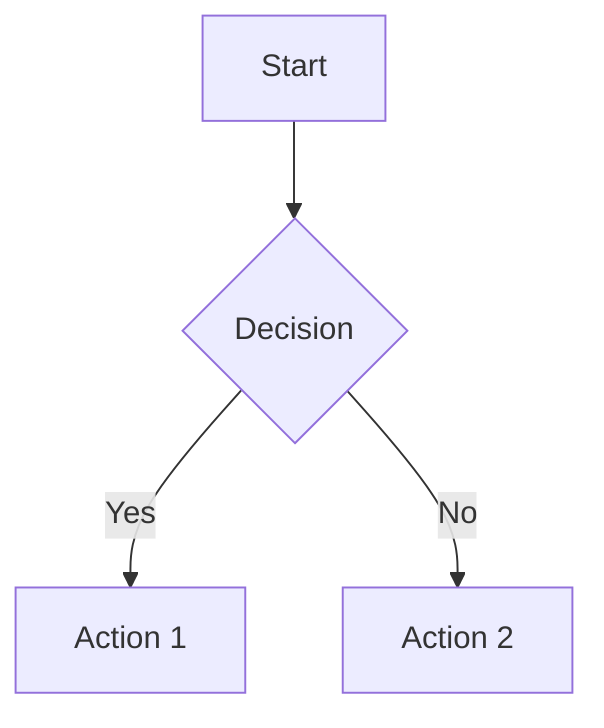

# Contributing to WaveMaker Documentation

Thank you for your interest in contributing to WaveMaker Documentation! This guide will help you understand our workflow, conventions, and best practices.

## Table of Contents

- [Getting Started](#getting-started)
- [Content Guidelines](#content-guidelines)
- [File Organization](#file-organization)
- [Writing Guidelines](#writing-guidelines)
- [Using the CLI Tool](#using-the-cli-tool)
- [Common Tasks](#common-tasks)
- [Review Process](#review-process)
- [Style Guide](#style-guide)
- [Best Practices](#best-practices)

## Getting Started

### Prerequisites

- **Node.js** >= 20.0
- **Git** with GitHub account
- **Code Editor** (VS Code recommended)
- Basic knowledge of [Markdown](https://guides.github.com/features/mastering-markdown/)
- Familiarity with [MDX](https://mdxjs.com/) (Markdown + JSX)

### Setup

1. **Clone the repository**
   ```bash
   # Option 1: Clone directly (for WaveMaker organization members)
   git clone https://github.com/wavemaker/docs.git
   cd docs

   # Option 2: Fork and clone (for external contributors)
   # Go to https://github.com/wavemaker/docs and click "Fork"
   # Then clone your fork:
   # git clone https://github.com/YOUR_USERNAME/docs.git
   # cd docs
   ```

2. **Install dependencies**
   ```bash
   npm install
   ```

3. **Start development server**
   ```bash
   npm start
   ```

4. **Create a feature branch**
   ```bash
   git checkout -b feature/your-feature-name
   ```

### Branches and pull requests

Work flows through two collection branches into `main`:

| Branch    | Receives                                                                                                         |
| --------- | ---------------------------------------------------------------------------------------------------------------- |
| `release` | Everything that ships with a release: release notes, tech stack, feature announcements, feature docs, blog posts |
| `docs`    | Anything we publish outside the release cycle                                                                    |

1. Branch from the collection branch you are targeting, and open your PR against it. Do not open PRs against `main` or `prod`.
2. PRs into a collection branch are **squash-merged**: one commit per PR, so intermediate commits and uncompressed originals stay out of the shared history.
3. Collection branches are merged into `main` with a **normal merge commit**, never a squash. A squash would lose the link to the collection branch, and a later revert or follow-up there would not reach `main`.
4. `main` is merged into `prod` the same way.
5. Work that needs its own branch for a while uses a temporary `feature/<name>` branch. It is merged into `main` with a normal merge commit, so its full history is kept, and then deleted. The `Assets` workflow doesn't run on these PRs by itself: the pre-commit hook covers contributors, and a maintainer can comment `/optimize-assets` on the PR into `main` to optimize and size-check it.

Maintainers: set the repository's default squash commit message to "Pull request title" (Settings → General → Pull Requests), so the `Assets-*` lines described below don't end up in the shared history.

## Content Guidelines

### File Types

- **`.md`** - Standard Markdown files
- **`.mdx`** - Markdown with JSX components (preferred)

### Frontmatter

Every documentation file should include frontmatter:

```yaml
---
last_update: { author: "Author Name" }
tags: [tag1, tag2]           # Optional
---
```

### Content Structure

```markdown
---
last_update: { author: "Author Name" }
---

# Overview

Brief introduction to the topic.

## Prerequisites

What users need before starting.

## Basic Usage

Step-by-step instructions.

## Advanced Features

More complex scenarios.

## Examples

Practical examples with code snippets.

## Troubleshooting

Common issues and solutions.

## Related Topics

Links to related documentation.
```

## File Organization

### Directory Structure

```
docs/
├── apis-and-services/       # Backend APIs and services
├── user-interfaces/         # UI components and frameworks
│   ├── web/                # Web-specific documentation
│   └── mobile/             # Mobile-specific documentation
├── studio/                 # WaveMaker Studio documentation
├── build-and-deploy/       # Deployment guides
├── design-system/          # Design system documentation
└── guide/                  # General guides and tutorials
```

### Naming Conventions

- **Files**: Use kebab-case: `my-component.md`
- **Directories**: Use kebab-case: `user-interfaces/`
- **Images**: Use descriptive names: `login-form-example.png`

### Asset Organization

```
static/
├── img/
│   ├── component-icons/    # Component icons
│   ├── blogs/             # Blog post images
│   └── section-img/       # Section-specific images
└── learn/
    └── assets/            # Documentation assets
```

### Asset size limits

Every PR into `release` or `docs` runs the `Assets` workflow on the images, GIFs, and videos it adds or changes. It first compresses them in place and commits the result back to the PR branch, keeping each file's name and format. It then checks the final sizes against these limits:

| Type  | Extensions                                        | Limit |
| ----- | ------------------------------------------------- | ----- |
| Image | `.png`, `.jpg`, `.jpeg`, `.webp`, `.avif`, `.svg` | 2 MB  |
| GIF   | `.gif`                                            | 10 MB |
| Video | `.mp4`, `.webm`, `.mov`                           | 50 MB |

Limits live in `scripts/assets/config.mjs`. Run `npm run check-assets` to check your branch locally.

#### Optimizing before you commit

When you commit staged images, GIFs, or videos from a terminal, the pre-commit hook optimizes them and lets you review the results:

1. It writes each optimized file to your working tree. Your commit still has the original until you decide.
2. For each file it shows the before and after size. Press Enter to keep the optimized version, `d` to discard it and keep the original, `o` to open both versions side by side, `a` to keep all the remaining ones, or `q` to abort the commit.
3. Kept files are staged and the commit continues. Press Ctrl-C at any time to put the originals back.

Look at each result before you keep it. Compression is lossy for screenshots with small text, GIFs, and videos.

The hook records what it did as `Assets-Optimized`, `Assets-Reviewed`, or `Assets-Failed` lines at the end of the commit message. Each line names the file's content hash, so CI skips only files that still match. Leave those lines in place. A file you discard is recorded as reviewed, so CI won't re-compress it behind your back.

The hook does nothing, and CI optimizes the files instead, when there is no terminal (IDE commit buttons, scripts, agents), when you run `git commit -a` or `git commit <paths>`, when concluding a merge, or when you set `ASSETS_PRECOMMIT=skip`. A staged asset that also has unstaged edits is skipped until you stage it fully.

To optimize without committing, run `npm run optimize-assets` from the folder that holds your assets. Add `-- -r` to include subfolders (`npm run optimize-assets -- -r`). It skips anything in `.gitignore`. It also skips files this clone has already optimized or reviewed, which it tracks in `.husky/.asset-cache` (local only, not committed); add `-- --force` to process them again. It needs nothing beyond `npm install`.

#### In CI

Optimization runs automatically on PRs from branches in this repo into `release` or `docs`. On a PR into any other branch, a maintainer comments `/optimize-assets` to run it. PRs from the author's own fork are optimized the same way when the author has write access to this repo or is listed in `.github/asset-trusted-users.json` (a JSON array of `{ "id", "login" }` objects; maintainers add people there, only the numeric id is compared because usernames can be reused, and the workflow reads the file from the default branch). GitHub decides this, not commit emails. On PRs from any other fork, every push is only size-checked and the bot warns on the PR if assets are not optimized; a maintainer comments `/optimize-assets` to optimize them, and the fork must allow edits by maintainers. The workflow keeps one comment on the PR up to date with a before/after table and the size check, and sets the `asset-size-check` status, which blocks merging while any asset is over its limit. After the bot commits, pull before you push again. Assets you kept as is in the pre-commit hook are left alone; to have CI optimize one anyway, a maintainer comments `/optimize-assets force <file name>` (for example `/optimize-assets force demo.mp4`; list several names separated by spaces, match by the end of the path, or give no name to redo every changed asset of the PR). A file is replaced only when the result is at least 10% smaller. Because PRs are squash-merged, the original uncompressed files never reach the collection branches or `main`.

### Pointer files

Large assets can live in the asset bucket instead of the repository. In their place the repository holds a short text file at the asset's own path, whose first line is `s3-asset v1`. Pages reference the asset exactly as before (``), and the site build turns the file into the bucket URL. Do not create or edit these files by hand: the `asset-pointer-check` status fails when a pointer is invalid or its object is missing from the bucket. Use inline markdown images or `require()`/`import` for assets; reference-style images (`![alt][ref]`) are not supported. The format and the checks are described in `plugins/pointer-assets/README.md`.

#### How assets get into the bucket

The `Assets` workflow runs three flows. Each has its own repository variable (Settings, Secrets and variables, Variables) and its own commit status, and any of them can be off:

| Flow     | Variable         | On when            | Status                | What it does                                                                                                        |
| -------- | ---------------- | ------------------ | --------------------- | ------------------------------------------------------------------------------------------------------------------- |
| Optimize | `ASSET_OPTIMIZE` | not set to `false` | `asset-size-check`    | Compresses assets in place. Size limits are checked even when this flow is off.                                     |
| Upload   | `ASSET_UPLOAD`   | set to `true`      | `asset-upload-check`  | Stores each new or changed asset in the bucket under a key that contains its hash. Never changes the PR.            |
| Replace  | `ASSET_REPLACE`  | set to `true`      | `asset-replace-check` | Swaps a stored asset for a pointer file, only on PRs into `release` and `docs`, and only once the object is public. |

A flow that is off, or does not apply, reports success, so it never blocks a merge. All three need permission to act: a branch in this repo, a trusted author, or a maintainer's `/optimize-assets` comment. The bucket, region and folder come from the variables `ASSET_S3_BUCKET`, `ASSET_S3_REGION` and `ASSET_S3_PREFIX`, and the credentials from the secrets `AWS_ACCESS_KEY_ID` and `AWS_SECRET_ACCESS_KEY`. The replace flow refuses to run when those variables do not describe the base URL in `docusaurus.config.js`.

An object is never overwritten or deleted by the pipeline: the key contains the hash of the bytes, so a changed file is a new object, and an upload that finds an object with the same key but other content fails. A failed upload blocks the merge; after a re-run, a maintainer can comment `/allow-upload-failure` to let the current head commit through. In the same way, a maintainer can comment `/allow-size-failure` to let a commit through whose assets are over the size limits (the limits apply whether or not optimization is on). Each command sets only its own status, on the current head commit only, so a later push needs a new decision. The bot stops pushing after three bot commits in a row with no commit from a person in between.

To edit an asset that is now a pointer, run `npm run fetch-assets -- <pointer file or folder>`. It downloads the real file, checks its size and hash, and replaces the pointer with it. Commit the changed file like any other asset.

## Writing Guidelines

### Tone and Style

- **Clear and concise**: Use simple, direct language
- **User-focused**: Write from the user's perspective
- **Action-oriented**: Use active voice and imperative mood
- **Consistent**: Follow established patterns and terminology

### Formatting

#### Headers

```markdown
# Page Title (H1 - only one per page)
## Main Section (H2)
### Subsection (H3)
#### Details (H4)
```

#### Code Blocks

````markdown
```javascript title="example.js"
const example = {
  property: 'value'
};
```
````

#### Callouts

```markdown
:::note
This is a note callout.
:::

:::tip
This is a tip callout.
:::

:::warning
This is a warning callout.
:::

:::danger
This is a danger callout.
:::
```

#### Links

```markdown
<!-- Internal links -->
[Link text](./relative-path.md)
[Link text](../other-section/page.md)

<!-- External links -->
[External link](https://example.com)
```

#### Images

```markdown


<!-- With custom sizing -->

```

### Diagrams

Use Mermaid for diagrams:

````markdown

````

## Using the CLI Tool

Our documentation manager CLI tool helps maintain consistency:

```bash
npm run manage-docs
```

### Available Options

1. **Create a new sidebar** - Sets up a new documentation section
2. **Create a new category** - Adds a category to an existing sidebar
3. **Create a new doc** - Creates a new documentation page
4. **Rollback and Exit** - Undoes all changes from the current session

### CLI Workflow

1. Run `npm run manage-docs`
2. Select your desired action
3. Follow the interactive prompts
4. The tool will:
   - Create necessary files and directories
   - Update sidebar configurations
   - Apply consistent formatting
   - Maintain proper file organization

## Common Tasks

### Adding a New Documentation Page

#### Method 1: Using CLI Tool (Recommended)

```bash
npm run manage-docs
# Select "Create a new doc"
# Follow the prompts
```

#### Method 2: Manual Creation

1. **Create the file**
   ```bash
   # Example: docs/user-interfaces/web/new-component.mdx
   ```

2. **Add frontmatter and content**
   ```markdown
   ---
   title: "New Component"
   ---

   # New Component

   Component description and usage.
   ```

3. **Update sidebar configuration**
   ```javascript
   // In sidebar/sidebars/userInterfacesWebSidebar.js
   {
     type: 'doc',
     id: 'user-interfaces/web/new-component',
     label: 'New Component'
   }
   ```

### Adding a Blog Post

1. **Create the file**
   ```bash
   # Format: YYYY-MM-DD-title.md
   touch blogs/blog/2024-01-20-new-feature.md
   ```

2. **Add frontmatter**
   ```markdown
   ---
   title: "Introducing New Feature"
   authors: [author-key]
   tags: [feature, announcement]
   ---

   Brief summary of the post...

   <!--truncate-->

   Full blog content here...
   ```

3. **Update authors.yml** (if needed)
   ```yaml
   author-key:
     name: Author Name
     title: Position
     url: https://github.com/username
     image_url: https://github.com/username.png
   ```

### Adding Images

1. **Place images in appropriate directory**
   ```
   static/img/section-name/image-name.png
   ```

2. **Reference in documentation**
   ```markdown
   
   ```

### Creating a New Sidebar

1. **Use CLI tool**
   ```bash
   npm run manage-docs
   # Select "Create a new sidebar"
   ```

2. **Or manually create**
   ```javascript
   // sidebar/sidebars/newSidebar.js
   export default [
     {
       type: 'doc',
       id: 'new-section/overview',
       label: 'Overview'
     }
   ];
   ```

3. **Update main sidebar file**
   ```javascript
   // sidebar/sidebars.js
   import newSidebar from './sidebars/newSidebar';

   const sidebars = {
     // ... existing sidebars
     newSidebar,
   };
   ```

## Review Process

### Before Submitting

1. **Test locally**
   ```bash
   npm start
   # Verify your changes work correctly
   ```

2. **Check for broken links**
   ```bash
   npm run build
   # Fix any broken links or references
   ```

3. **Format code**
   ```bash
   npx prettier --write "**/*.{md,mdx,js,json}"
   ```

### Pull Request Guidelines

1. **Create descriptive title**
   - ✅ "Add authentication guide for REST APIs"
   - ❌ "Update docs"

2. **Include description**
   - What changes were made
   - Why the changes were necessary
   - Any breaking changes or considerations

3. **Link related issues**
   ```markdown
   Closes #123
   Related to #456
   ```

4. **Request appropriate reviewers**
   - Technical reviewers for accuracy
   - Content reviewers for clarity

### Review Checklist

- [ ] Content is accurate and up-to-date
- [ ] Writing follows style guidelines
- [ ] Links work correctly
- [ ] Images display properly
- [ ] Code examples are functional
- [ ] Sidebar navigation is correct
- [ ] No spelling or grammar errors

## Style Guide

### Language and Tone

- **Use active voice**: "Click the button" not "The button should be clicked"
- **Be direct**: "Configure the settings" not "You might want to configure the settings"
- **Use present tense**: "The system creates" not "The system will create"
- **Avoid jargon**: Explain technical terms when first used

### Formatting Standards

#### Lists

```markdown
<!-- Ordered lists for steps -->
1. First step
2. Second step
3. Third step

<!-- Unordered lists for options -->
- Option A
- Option B
- Option C
```

#### Code References

```markdown
<!-- Inline code -->
Use the `className` property to style components.

<!-- File paths -->
Navigate to `src/components/Button.jsx`.

<!-- UI elements -->
Click the **Save** button.
```

#### Capitalization

- **Sentence case for headings**: "Getting started with components"
- **Title case for proper nouns**: "WaveMaker Studio"
- **Consistent terminology**: Use the same terms throughout

### Content Organization

#### Page Structure

1. **Overview** - What this page covers
2. **Prerequisites** - What users need first
3. **Main content** - Step-by-step instructions
4. **Examples** - Practical demonstrations
5. **Troubleshooting** - Common issues
6. **Related topics** - Links to related content

#### Information Hierarchy

- Use headings to create clear structure
- Keep sections focused and concise
- Use callouts for important information
- Include code examples where helpful

## Best Practices

### Content Creation

1. **Start with user needs**
   - What problem does this solve?
   - What does the user want to accomplish?

2. **Provide context**
   - Explain why something is important
   - Show how it fits into the bigger picture

3. **Include examples**
   - Real-world scenarios
   - Complete, working code samples
   - Screenshots when helpful

4. **Test your instructions**
   - Follow your own steps
   - Verify all links and references
   - Check on different devices/browsers

### Maintenance

1. **Keep content current**
   - Update for new features
   - Remove outdated information
   - Verify links regularly

2. **Monitor feedback**
   - Address user questions
   - Improve unclear sections
   - Add missing information

3. **Collaborate effectively**
   - Communicate with team members
   - Share knowledge and insights
   - Review others' contributions

### Performance

1. **Optimize images**
   - Use appropriate file formats
   - Compress images for web
   - Include alt text for accessibility

2. **Minimize bundle size**
   - Avoid large embedded assets
   - Use external links for large files
   - Optimize code examples

## Tools and Resources

### Recommended Tools

- **Editor**: [VS Code](https://code.visualstudio.com/) with Markdown extensions
- **Image editing**: [GIMP](https://www.gimp.org/) or [Figma](https://figma.com/)
- **Diagrams**: [Mermaid Live Editor](https://mermaid.live/)
- **Screenshots**: [Snagit](https://www.techsmith.com/screen-capture.html) or built-in tools

### Useful Extensions (VS Code)

- Markdown All in One
- MDX
- Prettier - Code formatter
- GitLens
- Spell Right

### References

- [Docusaurus Documentation](https://docusaurus.io/docs)
- [MDX Documentation](https://mdxjs.com/docs/)
- [Mermaid Documentation](https://mermaid.js.org/)
- [Markdown Guide](https://www.markdownguide.org/)

## Getting Help

### Questions and Support

- **GitHub Issues**: For bugs and feature requests
- **GitHub Discussions**: For questions and general discussion
- **Team Chat**: Internal communication channels
- **Documentation**: This guide and Docusaurus docs

### Reporting Issues

When reporting issues, include:

1. **Clear description** of the problem
2. **Steps to reproduce** the issue
3. **Expected vs actual behavior**
4. **Environment details** (browser, OS, etc.)
5. **Screenshots** if applicable

---

Thank you for contributing to WaveMaker Documentation! Your efforts help make our platform more accessible and user-friendly for everyone.
