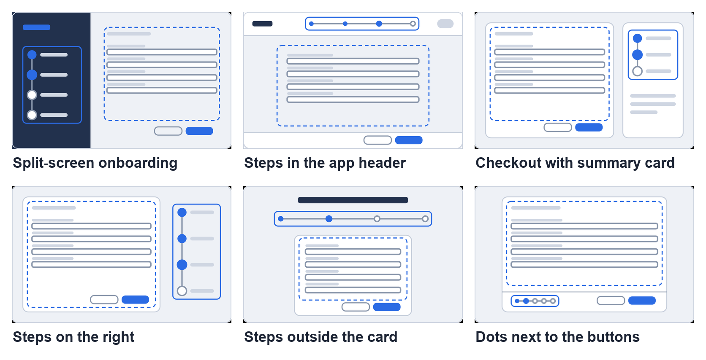
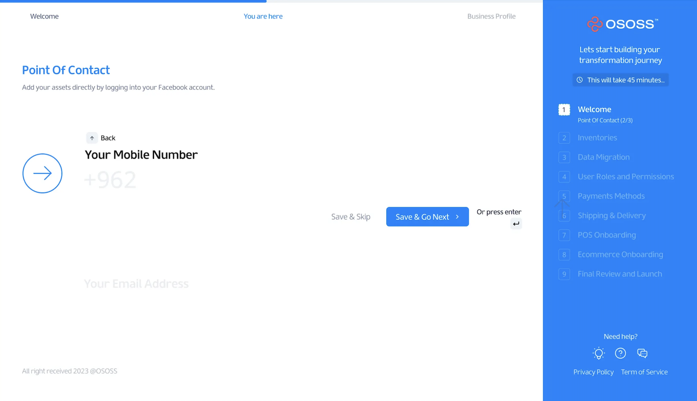
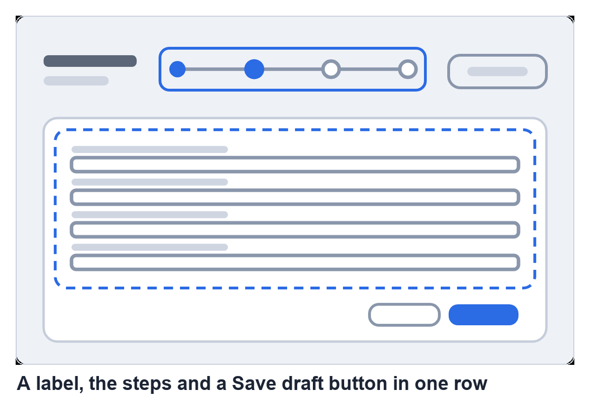
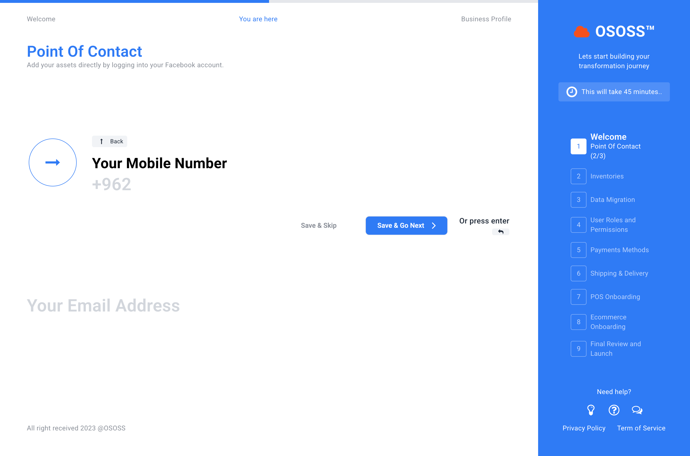
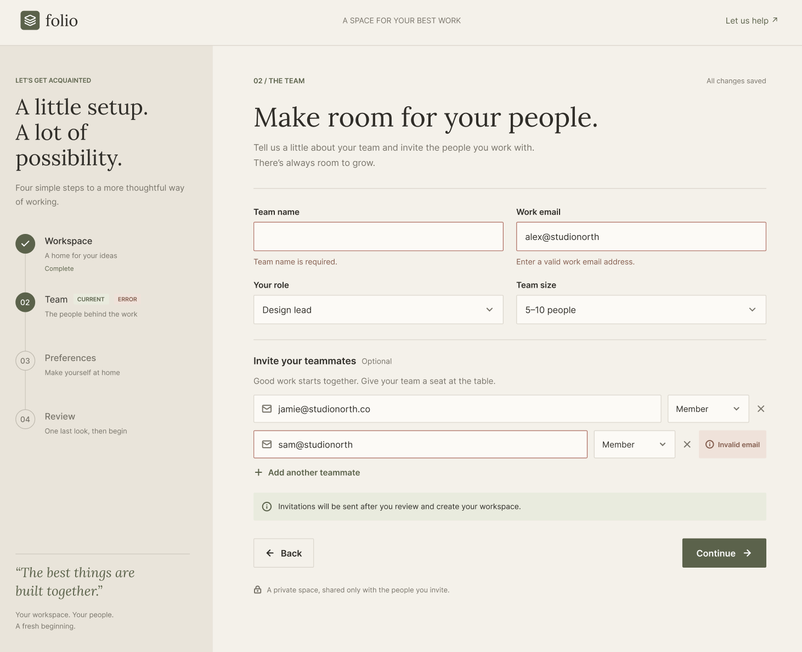
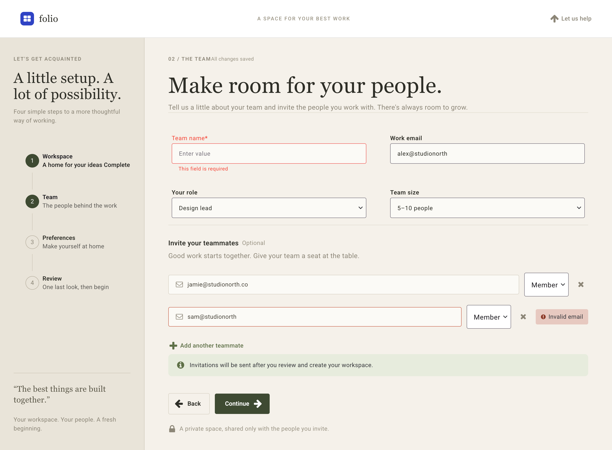
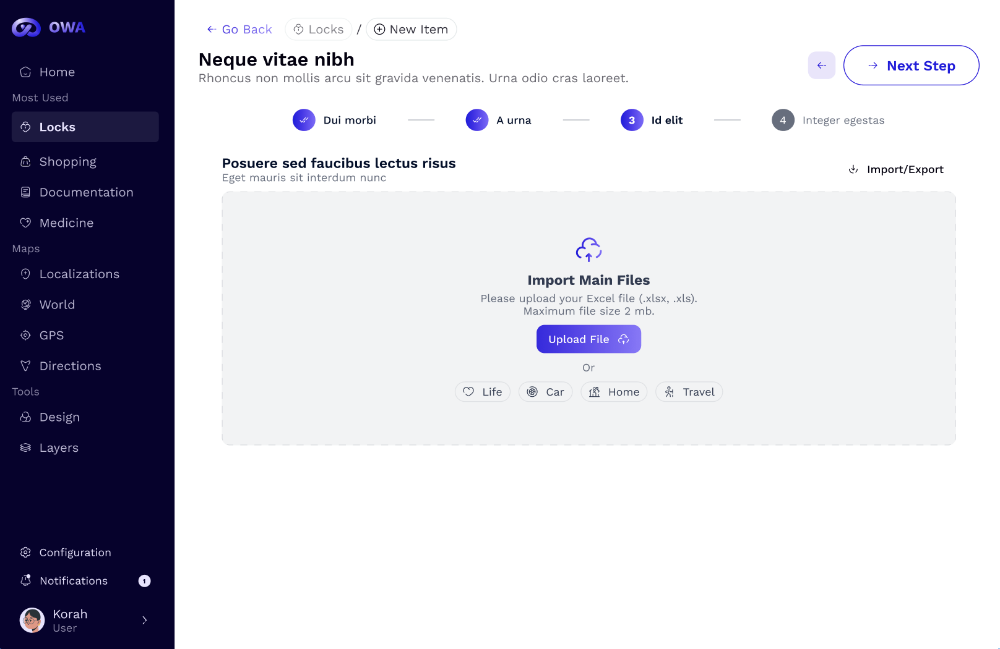
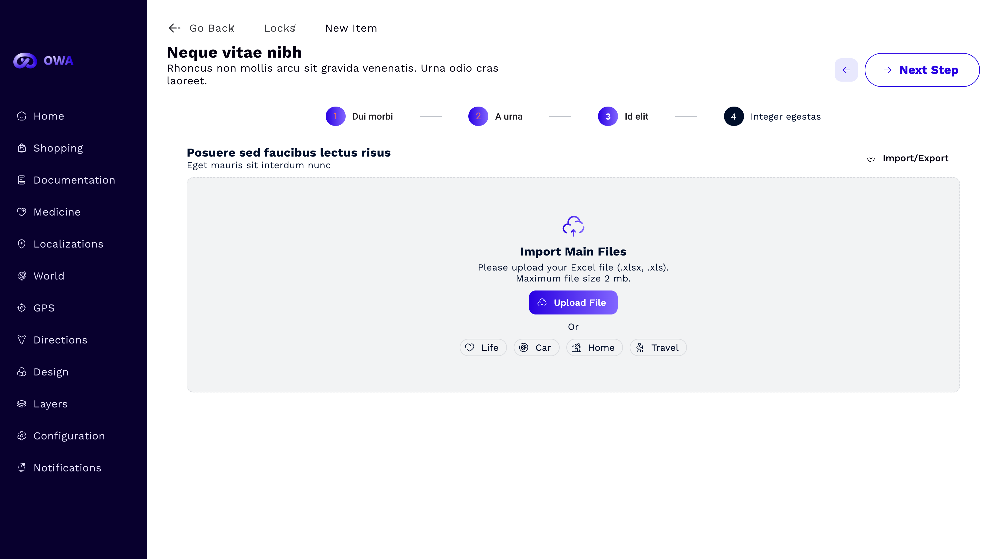

import wizardStepperDragVideo from './assets/videos/wizards-unlocked/wizard-stepper-drag.mp4';
import wizardStepperDragPosterImage from './assets/videos/wizards-unlocked/poster.jpg';

**Put your wizard's stepper anywhere on the page, with your own text and buttons right beside them. Your wizards can now look exactly like the design.**

---

<PillGroup>
  <Pill type="design-to-code" text="Design-To-Code" />

  <Pill type="ai" text="AI Agents" />

  <Pill type="web" />

  <Pill type="studio" text="WaveMaker Studio" />

  <Pill type="figma" />
</PillGroup>

---

Your designer puts the steps in a side panel. Or in the header. Or right next to the order summary.

Until now, a WaveMaker wizard could only put them on top or on the left. Starting with **WaveMaker 12.1.2**, the steps are their own widget, the **Wizard Stepper**, and they go wherever the design says.

{/* truncate */}

<video controls width="100%" muted playsInline poster={wizardStepperDragPosterImage}>
  <source src={wizardStepperDragVideo} type="video/mp4" />
</video>

*Dragging the stepper out of a wizard in Studio and dropping it into another container.*

---

## Your wizard, any layout

Here are a few layouts that are now possible:



Each of these used to mean a compromise. Now it's a drag and drop.

Take this real onboarding design:



It has three things the old wizard simply could not do:

- The vertical stepper is on the right.
- There's text above and below the stepper.
- The stepper is outside the wizard.

Now you can build it exactly as drawn, or generate it straight from a screenshot. You'll find it, and other real pages built with these layouts, in the examples further down.

---

## Two layouts, no exceptions

The wizard used to draw its own steps. You couldn't select them in Studio, move them, or style them on their own. So every wizard you built had one of two layouts:


That was it, and it got in the way a lot:


- **Steps stuck in the wizard.** Steps in a side panel, in the header, or next to an order summary just weren't possible.
- **Nothing next to the steps.** A label, a help link or a Save draft button beside the stepper had nowhere to go, because that whole row belonged to the wizard.
- **Close, but not quite the design.** When your designer handed you a layout, you'd end up with something close to it, but not quite it.
- **Extra CSS on generated pages.** Pages generated by Autocode and Screenshot-to-Code hit the same wall and needed extra workaround CSS to get close to the design.

> The design said one thing. The wizard allowed another.

---

## What you get now

Build the layout your designer drew, not the closest thing the wizard allowed.

<StatPills>
  <StatPill color="blue" label="Steps anywhere" description="put progress where your users look: a side panel, the header, a summary card, beside the form or next to the buttons" />

  <StatPill color="green" label="Room beside the steps" description="add context right next to them, such as a label, a help link or a Save draft button" />

  <StatPill color="indigo" label="Closer to the design" description="pages generated from your screenshots and Figma designs match the original, without extra CSS" />
</StatPills>

---

## Build it in Studio

1. Drop a Wizard on the page. The Wizard Stepper comes with it, nested inside, so by default nothing looks different.
2. Select the stepper on the canvas. It's a regular widget, so you can select it, drag it and style it like any other.
3. Drag it wherever the design wants it, such as a side panel, the header, a summary card or another container, and place text, buttons or anything else right next to it.
4. In the stepper's Properties panel, set its appearance (number, icon, dotted or tab) and its orientation (horizontal or vertical).


*The Wizard Stepper selected in Studio, with its Properties panel open.*

For example, here's a label, the steps and a Save draft button in one row above the wizard:



Wherever you put it, the stepper stays linked to its wizard. It still highlights the current step and lets users click back to a finished one. The stepper takes care of the steps, and the wizard takes care of the content and the card around it.

You can style the steps on their own too. The stepper has its own design tokens, separate from the wizard's, so changing how the steps look doesn't touch the wizard's card.

It works the same in Angular and React apps, whether the stepper is inside the wizard or somewhere else on the page. The Wizard Stepper is for web apps only for now. Mobile wizards haven't changed.

### For developers: the markup

In markup, the stepper is a `wm-wizardstepper` widget, linked to its wizard through `wizardname`. Its appearance and orientation are set with `class` and `variant`:

```html
<wm-wizard name="wizard1">
  <wm-wizardstepper wizardname="wizard1" class="wizard-iconstepper"
      variant="iconstepper:vertical"></wm-wizardstepper>
  <wm-wizardstep title="Account"></wm-wizardstep>
  <wm-wizardstep title="Profile"></wm-wizardstep>
</wm-wizard>
```

---

## Or let AI build it for you

You don't have to place the stepper by hand. Screenshot-to-Code and Autocode now generate the Wizard Stepper too, so the pages they create keep the steps exactly where your design has them. Switch between the tabs in each example to compare the design with the page generated from it.

### From a screenshot

Screenshot-to-Code places the steps, the wizard content and the action buttons each where your screenshot shows them. If the screenshot has the steps in a sidebar, you get them in a sidebar instead of squeezed on top.

#### Example 1: steps in a panel on the right

<TabsWrapper>
  <TabItem name="Screenshot">
    
  </TabItem>

  <TabItem name="Generated page">
    
  </TabItem>
</TabsWrapper>

#### Example 2: steps in a side panel

<TabsWrapper>
  <TabItem name="Screenshot">
    
  </TabItem>

  <TabItem name="Generated page">
    
  </TabItem>
</TabsWrapper>

#### Example 3: steps above the card

<TabsWrapper>
  <TabItem name="Screenshot">
    
  </TabItem>

  <TabItem name="Generated page">
    
  </TabItem>
</TabsWrapper>

### From a Figma design

Wizards that Autocode generates from your Figma designs now include the Wizard Stepper, inside the wizard or on its own to match your Figma frame, with the styling on the right part of the wizard. It works with both the Material and Generic design systems, and the stepper's look comes from design tokens, so you can tweak all of it in Studio's style panel.

#### Example 1: Generic design system, steps in a side card

<TabsWrapper>
  <TabItem name="Figma design">
    
  </TabItem>

  <TabItem name="Generated page">
    
  </TabItem>
</TabsWrapper>

#### Example 2: Generic design system, steps above the content

<TabsWrapper>
  <TabItem name="Figma design">
    
  </TabItem>

  <TabItem name="Generated page">
    
  </TabItem>
</TabsWrapper>

#### Example 3: Material design system

<TabsWrapper>
  <TabItem name="Figma design">
    
  </TabItem>

  <TabItem name="Generated page">
    
  </TabItem>
</TabsWrapper>

---

## Already have wizards? Nothing to do.

Your existing wizards keep working and look exactly as they did before, with no manual work. When you upgrade, each wizard is updated for you:

- A Wizard Stepper is added as the first thing inside each wizard, so the steps show up where they always did.
- The wizard's appearance (numbers, icons, dots or tabs), orientation and theme tokens move over to the new stepper.

After that, you can drag the stepper anywhere, just like in a new wizard.

---

## What's next

Moving the stepper around is step one. We're also planning to let you change the layout inside the stepper, so you can lay out each step's title, subtitle and icon anywhere around the step instead of picking from a fixed set of styles.

Give it a try: drop a Wizard, drag the stepper somewhere new, and run it.
