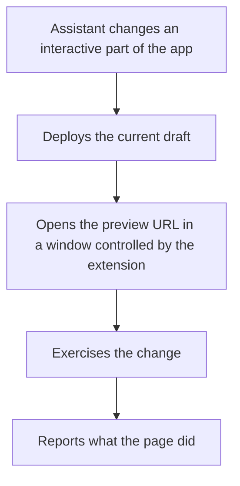
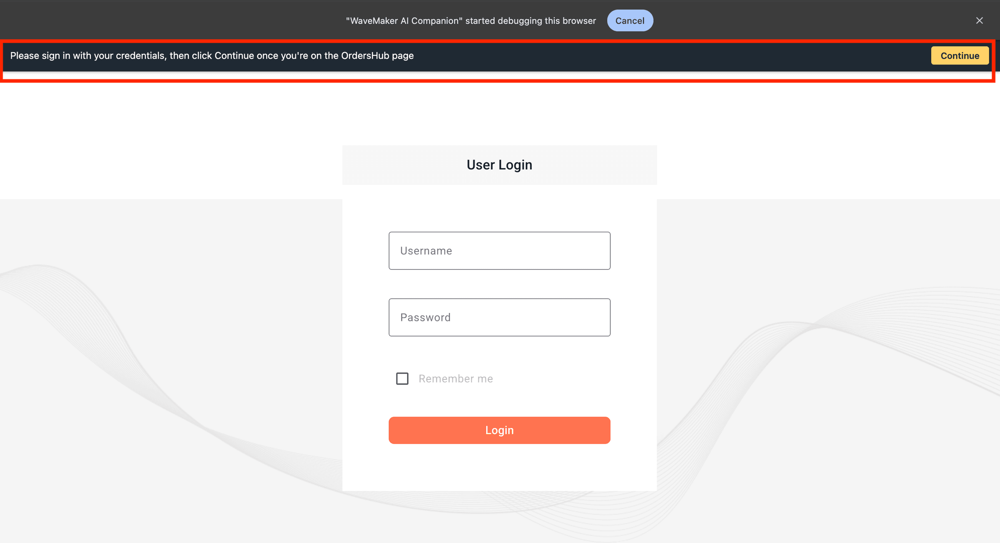

WaveMaker AI Assistant can verify your app's behavior in real time. The assistant launches the app in a separate browser instance locally on your machine, verifies the intended behavior, and generates more accurate code. This reduces guesswork by the assistant and the number of prompts required to reach the intended result.

## When the assistant verifies

When you prompt the WaveMaker AI Assistant for an implementation, it can launch your web app in the following situations:

- **When the intended behavior affects the UI of the app.** For example, a button action, date formatting in a list of transactions, or an API binding with a data table.
- **When a problem is reported and the root cause is not certain.** For a request such as "the countries list dropdown is empty" or "the Dashboard page is not responsive", the assistant reproduces the problem in the browser first, and only then reads the code.

It ends with a clear verdict: a bug in your app, something for the platform team, couldn't reproduce it, or couldn't get far enough to tell.

In this recording, the assistant reproduces a reported OTP focus problem, reports an app bug, and asks before fixing it.

<video controls width="100%" muted playsInline poster={require('./assets/vids/verify-in-browser-poster.jpg').default}>
  <source src={require('./assets/vids/verify-in-browser.mp4').default} type="video/mp4" />
</video>

## How verification works

The assistant opens the application in a separate browser window controlled by the [WaveMaker AI Companion](https://chromewebstore.google.com/detail/dblmconkjbhphedkodkehacfiddcenjc) Chrome extension and works inside that window. Verification runs over the connection Studio already holds.

The window stays open for the rest of the conversation and closes shortly after the work finishes. Later verifications in the same chat reuse it.

## Sign in and other prompts

Some pages need a person before they can be exercised: a login form, a one-time password, or a consent screen. When the assistant reaches one, it places a prompt bar in that window and waits for you to complete the step and select **Continue**.

The assistant waits up to five minutes. It does not report the task as blocked and does not ask for credentials in the chat. If the wait expires, the verification ends and the report says why.

## Skip browser verification

The prompt box has a **Skip browser verification** toggle. Check it if you do not want the AI Assistant to verify the app and just generate code. The setting is fixed once the chat starts and applies until the chat session ends.

Keep this unchecked so the assistant can get a better view of the problem before generating the code. This is especially crucial for complex apps, and can save the developer multiple iterations.

Mobile projects do not support this feature as of now.

## Requirements and limitations

- **Companion Chrome extension.** Browser verification needs the [WaveMaker AI Companion](https://chromewebstore.google.com/detail/dblmconkjbhphedkodkehacfiddcenjc) installed in Chrome. If it is missing, the assistant says so and gives the install link instead of continuing without verification.
- **Chrome only.** The assistant uses the browser the extension controls. Other browsers are not used.
- **Mobile projects.** Mobile projects do not support browser verification as of now.
