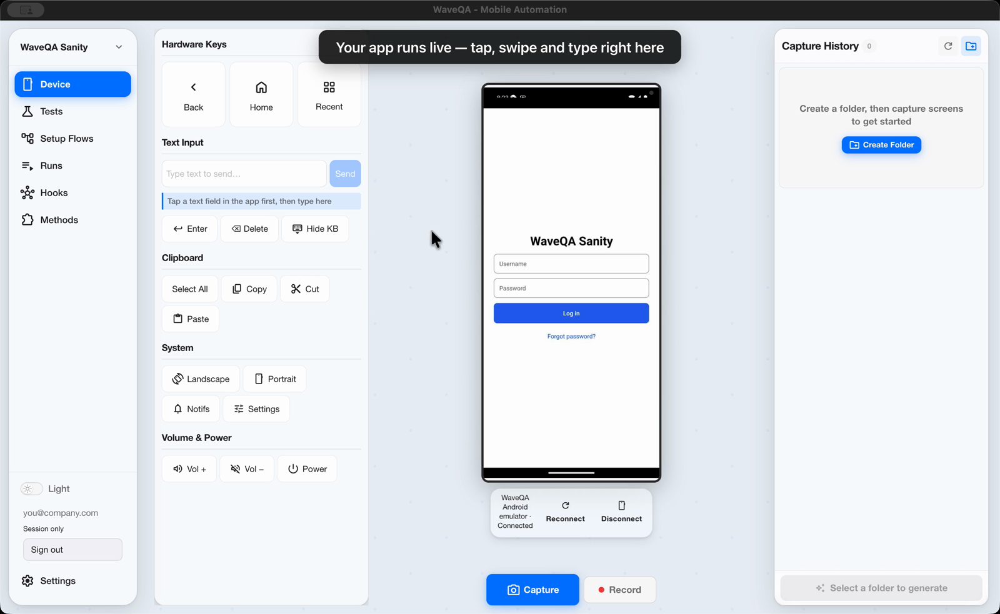
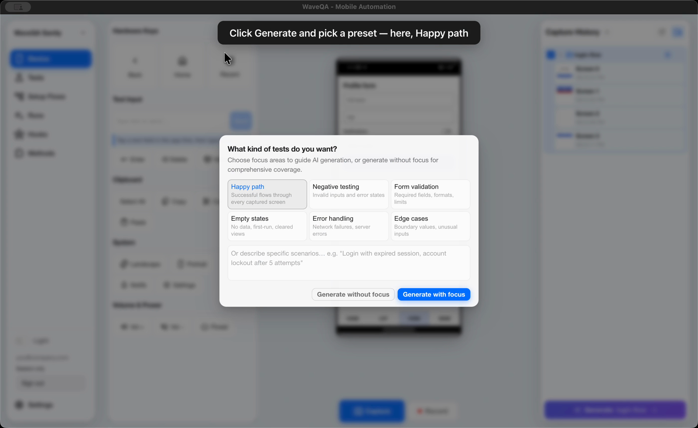
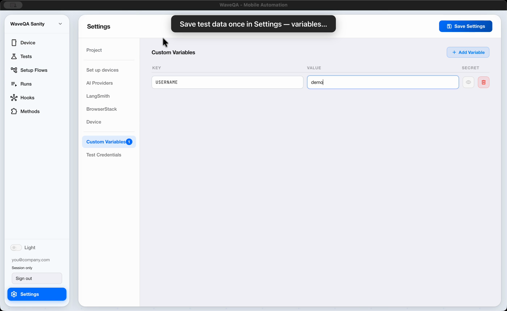

## Overview

WaveQA is a desktop app that turns screens you capture from your mobile app into automated UI tests. You connect WaveQA's own Android emulator or iPhone simulator, capture the screens of a flow, and let AI generate test cases with reusable setup flows. You then run the tests on the device and review a report for every run.

This guide walks you through your first project, from install to a passing run.

### WaveQA in 90 seconds

<video controls preload="metadata" width="100%" src={require('./assets/videos/WaveQA-marketing.mp4').default}>
  Your browser does not support embedded videos.
</video>

---

## Prerequisites

Before you begin, make sure you have:

- A Mac with Apple silicon (M1 or later) running macOS 12 or newer.
- About 15 GB of free disk space for the first Android setup.
- A WaveMaker account.
- An API key for Anthropic (Claude), OpenAI or Google Gemini, used for test generation.
- Your app as an Android `.apk`, or an iOS simulator build (`.app`, zipped).
- For iOS testing only: Xcode, installed from the Mac App Store.

---

## Watch the Walkthrough

This narrated walkthrough (2 min 40 s) shows every step in this guide, from creating a project to generated tests.

<video controls preload="metadata" width="100%" src={require('./assets/videos/WaveQA-walkthrough-voiceover.mp4').default}>
  Your browser does not support embedded videos.
</video>

---

## Install WaveQA and Create a Project

1. Download `WaveQA-2.0.8-mac-arm64.dmg` from the [WaveQA releases page](https://github.com/sourab05/WaveQA-releases/releases/tag/v2.0.8).
2. Open the DMG and drag **WaveQA** into **Applications**.
3. The first time only, right-click **WaveQA** in **Applications**, choose **Open**, then choose **Open** again.
4. Sign in with your WaveMaker account.
5. On the start screen, enter a **Project name**.
6. Under **What are you testing?**, choose **Android** or **iOS**.
7. Add your app: drop the `.apk` (Android) or the zipped `.app` (iOS) onto the card.
8. Create the project.

:::note
This build is not yet signed by Apple, which is why macOS asks you to confirm the first launch. You can also allow it in **System Settings → Privacy & Security → Open Anyway**.
:::

---

## Connect a Device

1. Open the **Device** tab.
2. Click **Connect**.
3. If anything is missing, WaveQA opens device setup and shows what it will download and where it installs it (WaveQA's private folder, `~/.waveqa`). Accept the Android licences when asked. When setup finishes, Connect continues automatically.
4. Wait for your app to appear live on the device screen.

WaveQA uses its own emulator or simulator and never changes your existing Android SDK, emulators or simulators.

---

## Capture the Screens of a Flow

1. In **Capture History**, click **Create Folder** and name it, for example `login-flow`.
2. Use the app on the device screen: click to tap, drag to swipe, and type with **Text Input** on the left.
3. On each screen you want tested, click **Capture**.
4. Optionally, click **Record** to capture screens automatically while you use the app. Click it again to stop.

Each capture keeps a screenshot and the screen's layout, which is what the AI uses to write tests.

:::tip
Capture every distinct screen of the flow, including error states such as a wrong-password message.
:::

---

## Generate Tests with AI

1. Open **Settings → AI Providers**, choose your provider, enter your API key and click **Save Settings**. Keys are stored encrypted.

2. In **Capture History**, select the folder of captures.

3. Click **Generate**.

4. Pick one or more presets, describe what to cover in your own words, or both, then click **Generate with focus**.

   | Preset           | Covers                                         |
   | ---------------- | ---------------------------------------------- |
   | Happy path       | Successful flows through every captured screen |
   | Negative testing | Invalid inputs and error states                |
   | Form validation  | Required fields, formats, limits               |
   | Empty states     | No data, first-run, cleared views              |
   | Error handling   | Network failures, server errors                |
   | Edge cases       | Boundary values, unusual inputs                |

   

5. If the AI proposes setup flows (reusable steps such as reaching the login screen), review them and click **Save**.

   

6. Open the **Tests** tab. Click a test to review or edit its steps; each step uses elements from your captured screens.

---

## Use Your Own Test Data

The AI writes the values it saw or guessed, for example a sample username. To use real test accounts, save them once and reference them in steps.

1. Open **Settings → Custom Variables** and add a variable, for example `USERNAME` with your test user.
2. Open **Settings → Test Credentials** and add secrets such as `PASSWORD`. Credentials are stored encrypted and are never shown again.
3. Click **Save Settings**.
4. In a test or setup flow, edit a step and set its **Value** to the variable, for example `{{TEST_VAR_USERNAME}}` or `{{TEST_SECRET_PASSWORD}}`. You can also click **Insert variable**.

Values are filled in only when the test runs.

---

## Run Tests and Review Reports

1. On the **Tests** tab, run a single test, or click **Run All**.
2. Watch the run live: the device screen and step-by-step progress update as the test runs. You can **Stop** a run at any time.
3. Open the **Runs** tab, or click **View Report**, to see each step with its screenshot. A failed step shows the screen at the moment it failed.

To run your tests in CI, open the **Tests** tab, click **Export**, and choose WebdriverIO specs or a complete WebdriverIO project.

---

## Limitations and Constraints

- WaveQA 2.0.8 runs on macOS with Apple silicon only, and the build is not yet signed by Apple.
- iOS testing requires Xcode. The first iOS connection builds the automation helper, which takes a few minutes.
- The first Android setup downloads about 2.5 GB and needs about 15 GB of free disk space.
- Test generation sends captured screen layouts to the AI provider you choose. API keys and credentials are encrypted at rest and never shown in the app or in logs.
