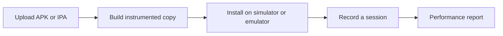

RN Perf Analyzer measures the runtime performance of a React Native app build and produces a report covering startup, screens, network calls, rendering, and memory.

<video controls width="100%" playsInline>
  <source src={require('./assets/vids/rn-perf-analyzer-demo.mp4').default} type="video/mp4" />
</video>

---

## Overview

RN Perf Analyzer works on the app build you already have. It takes an Android APK or iOS IPA, in release or debug mode, builds an instrumented copy that contains a performance agent, and installs that copy on a simulator or emulator. While you use the app, the agent records every screen visit, API call, and frame. When you stop recording, the analyzer turns the session into a scored report with ranked bottlenecks and suggested fixes.

[WavePulse](./wavepulse) inspects what an app is doing. RN Perf Analyzer measures how fast it does it.

---

## When to use

Use RN Perf Analyzer in the following scenarios:

- Measure cold or hot start time before a release.
- Find the screens with the slowest time to interactive (TTI).
- Identify slow, failing, or duplicate API requests and the time they waste.
- Trace excessive re-renders back to the components that cause them.
- Spot memory growth across navigations.

---

## How it works

### 1. Upload a build

Upload an Android APK or an iOS IPA. Release and debug builds are both supported. The analyzer detects that the app is a React Native app.

### 2. Build an instrumented copy

The analyzer builds an instrumented copy of the app with a performance agent inside.

### 3. Install on a device

Select a simulator or an emulator. The analyzer installs the instrumented build from the dashboard.

### 4. Record a session

Choose a cold or hot start and start recording. The analyzer measures the launch, then traces each screen you open, each API call, and each frame as you use the app. Use the app the way your users would, covering the flows you want to measure.

### 5. Stop and review the report

Stop recording. The report is ready as soon as the session ends.

---

## Reading the report

The report is organized into tabs. Each tab focuses on one area of the session.

| Tab              | What it shows                                                                                                                                                                         |
| ---------------- | ------------------------------------------------------------------------------------------------------------------------------------------------------------------------------------- |
| **Overview**     | An overall score, along with sub-scores for Startup, Navigation, Network, JS, Rendering, Memory, and Stability. Lists the biggest bottlenecks, ranked, each with a suggested fix.     |
| **Startup**      | The launch broken into phases: time to initial display (TTID), JS initialization, first render, and time to interactive (TTI).                                                        |
| **Screens**      | One row per visited screen with its TTI, API calls, dropped frames, long tasks, memory change, and score.                                                                             |
| **Network**      | Request and endpoint counts, median latency, and failed and slow requests. Highlights time wasted on duplicate requests and time that could be saved by running requests in parallel. |
| **Rendering**    | Frame rate, jank percentage, dropped frames, commits, and excessive re-renders, with re-render counts per component.                                                                  |
| **Memory & CPU** | Peak and ending memory, memory growth per navigation, leak suspects, and CPU usage for the UI and JS threads.                                                                         |
| **Timeline**     | Every recorded event on a single timeline, so a slow request, a dropped frame, and a memory jump can be read side by side.                                                            |

:::tip
Start with the **Overview** score to see which area needs attention, then open that area's tab for the details.
:::

---

## Summary

- **Works on existing builds**: Android APK or iOS IPA, release or debug.
- **Instrumented copy**: the analyzer adds its performance agent to a copy of the app.
- **Real usage sessions**: records cold or hot starts and the flows you go through on a simulator or emulator.
- **Scored report**: startup, screens, network, rendering, memory, and a combined timeline.
- **Actionable output**: ranked bottlenecks, each with a suggested fix.
