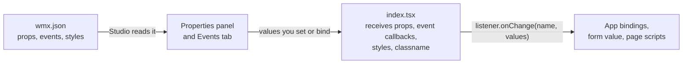

# Create a WMX component

A WMX component is a React component plus a `wmx.json` file that tells Studio what properties and events it has. You can write both yourself or ask the AIRA WMX agent to generate them, as described in [Create WMX components with AIRA](/docs/user-interfaces/mobile/enterprise-capabilities/wmx/wmx-with-aira). Ask for a React **web** component.



## Step 1: Create the folder

In `src/main/webapp/extensions/components/src/`, create a folder named after the component, for example `StatusBadge/`, with `index.tsx` and `wmx.json`.

## Step 2: Describe the component in `wmx.json`

```json
{
  "name": "StatusBadge",
  "displayName": "Status Badge",
  "description": "Shows a status as a colored badge",
  "webSupport": true,
  "props": {
    "text": {
      "name": "text",
      "displayName": "Text",
      "type": "string",
      "defaultValue": "Active"
    },
    "color": {
      "name": "color",
      "displayName": "Color",
      "type": "string",
      "defaultValue": "#22C55E"
    }
  },
  "events": {
    "onClick": {
      "name": "onClick",
      "displayName": "On Click",
      "description": "Triggered when the badge is clicked."
    }
  },
  "styles": {
    "root": {
      "name": "root",
      "style": { "borderRadius": "999px", "padding": "2px 10px" }
    }
  }
}
```

- `props`, `events` and `styles` are maps. The key is the name, and it must match the `name` inside the entry.
- A property `type` can be `string`, `number`, `boolean`, `object` or `array`.
- Style values are CSS, for example `"8px"` or `"#ffffff"`.
- Do not declare `show`, `name`, `disabled`, `classname`, `styles` or `showindevice`. Studio provides them for every component.

The full list of fields is in the [WMX schema reference](/docs/user-interfaces/mobile/enterprise-capabilities/wmx/wmx-schema-reference).

## Step 3: Write `index.tsx`

Export the component as the **default export**. Studio passes in:

- every property you declared in `wmx.json`
- every event you declared, as a callback (`onClick`)
- `styles`, an object with one entry per style slot, shaped like `{ root: { style: {...} } }`
- `classname`, `name` and `disabled`

```tsx
import React, { CSSProperties } from "react";

interface StatusBadgeProps {
  text?: string;
  color?: string;
  classname?: string;
  styles?: { root?: { style?: CSSProperties } };
  onClick?: () => void;
}

const StatusBadge = ({
  text = "Active",
  color = "#22C55E",
  classname = "",
  styles,
  onClick,
}: StatusBadgeProps) => (
  <span
    className={`statusbadge ${classname}`}
    style={{ background: color, color: "#fff", ...styles?.root?.style }}
    onClick={() => onClick?.()}
  >
    {text}
  </span>
);

export default StatusBadge;
```

Apply `classname` and the `root` style to the outermost element so class and style settings from Studio take effect.

### Send a value back to the app

If your component changes one of its own properties, for example the selected values in a multi-select, tell the app with `listener.onChange`. Studio passes `listener` and `name` in. Without this call, bindings and page scripts keep seeing the old value.

```tsx
listener?.onChange?.(name, { datavalue: selectedValues });
```

The object holds the property names and their new values. In the multi-select example, `datavalue` is the form field's value.

## Step 4: Add the icon and libraries (optional)

- Add an `icon.svg` with a transparent background and a `#737373` stroke. Studio shows it next to the component.
- If your component needs a library such as a date library, list it in the component's `package.json`.

## Next steps

Preview the component in your browser with [Develop and test a WMX component locally](./develop-locally.md), then [use it in your app](./use-wmx-component.md).
