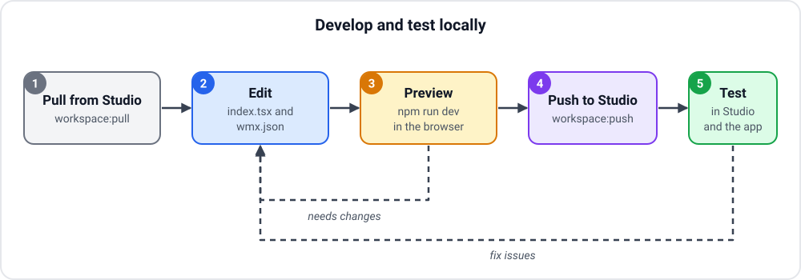

# Develop and test a WMX component locally

Edit your component in your own editor, check it in the browser, and then push it to Studio.



## Prerequisites

- Node.js and npm.
- A local copy of your project, set up as described in [Set up WaveMaker project locally](/docs/guide/integration/set-up-wavemaker-project-locally/).

## Step 1: Get the latest project

```bash
mvn wavemaker-workspace:pull
```

Your components are in `src/main/webapp/extensions/components/src/`.

## Step 2: Preview a component on its own

A component folder can include `index.html` and `main.tsx` files that render the component with sample data. Use them to check the component without running the whole app.

```bash
cd src/main/webapp/extensions/components/src/MultiSelect
npm install
npm install --save-dev vite
npm run dev
```

Open the address that Vite prints, usually `http://localhost:5173`. Edits to `index.tsx` appear in the browser right away.

You only need `npm install --save-dev vite` once per component, and only if `vite` is not already in the component's `package.json`.

:::note
If a component folder has no `index.html` and `main.tsx`, create them. `main.tsx` imports your component and renders it with sample property values, as shown here:

```tsx
import React from "react";
import ReactDOM from "react-dom/client";
import StatusBadge from "./index";

ReactDOM.createRoot(document.getElementById("root")!).render(
  <StatusBadge text="Active" color="#22C55E" />
);
```

`index.html` needs a `<div id="root"></div>` and `<script type="module" src="/main.tsx"></script>`.
:::

The preview shows how the component looks and responds with the sample values you pass. It does not run Studio bindings or events. Check those in the app, as in step 4.

## Step 3: Push the component to Studio

```bash
mvn wavemaker-workspace:push
```

Refresh the project in Studio. The component is now available to use.

## Step 4: Test it in the app

Use the component on a page as described in [Use a WMX component in your app](./use-wmx-component.md), then run the app and check that:

- properties show the values you bound
- events trigger the handlers you added
- the value is saved correctly if the component is a form field

## Troubleshooting

| Problem                              | What to check                                                                    |
| ------------------------------------ | -------------------------------------------------------------------------------- |
| `vite: command not found`            | Run `npm install --save-dev vite` in the component folder.                       |
| Blank page in the preview            | Open the browser console. Check that `index.tsx` has a default export.           |
| Component is missing in Studio       | The folder must contain `wmx.json`. Push again and refresh.                      |
| Placeholder shows in the running app | Push the latest files and refresh the project in Studio, then run the app again. |
