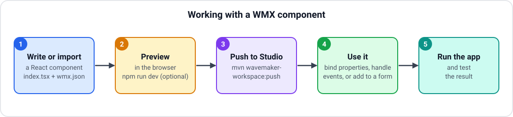

# WMX components

**WMX components (WaveMaker Extension components)** let you bring any React component into a WaveMaker web app. Write your own, or wrap one from a library such as a carousel, a chart or a rich-text editor. WaveMaker then treats it like a built-in widget.

WMX components support property binding, event handling, scripting and styling. You keep control of the UI code in `index.tsx`. The platform supplies the integration layer.

WMX components are also available for [React Native mobile apps](/docs/user-interfaces/mobile/enterprise-capabilities/wmx/). The folder layout and `wmx.json` format are the same. On web you write HTML elements. On mobile you write React Native views.

:::note
WMX components (React) are supported in React web apps only. They are not supported in Angular web apps.
:::

## Why use WMX components

WaveMaker ships a large widget set, but some apps need something else. WMX components are a good fit when you need:

- A control that is not in the widget library, such as a carousel or a multi-select with chips
- A custom input that works as a field in a WaveMaker form, with validation and submit
- A third-party React library as a first-class widget
- A reusable component shared across projects, configured from Studio

## Capabilities

WMX components allow you to:

- Import any React component into WaveMaker
- Bind component properties to variables and page data
- Trigger and handle component events on the page
- Read and set component properties from page scripts
- Use the component as a field in a WaveMaker form
- Apply classes and style settings
- Use third-party React libraries

## Key benefits

- **Script access:** use `Page.Widgets.<componentName>` like any other widget
- **Studio configuration:** properties and events from `wmx.json` appear in the Properties panel
- **Data binding:** bind properties to variables, other widgets and page data
- **Form integration:** the component can be a form field and take part in validation and submit
- **Lightweight integration:** a thin layer around your React code

## How you work with it



## WMX component file structure

All components live under:

`src/main/webapp/extensions/components/src/`

Organize each component in its own folder:

```text
src/main/webapp/extensions/components/src/
├── WidgetName/
│   ├── index.tsx
│   ├── wmx.json
│   ├── icon.svg (optional)
│   └── package.json (optional)
```

### index.tsx

- Contains the component UI and logic.
- Must export the component as the **default export**.

### wmx.json

- Defines the component name, properties, events and styles.
- Studio builds the Properties panel from this file.

### icon.svg (optional)

- The component icon in Studio. Use a transparent background and a `#737373` stroke, and keep it simple.

### package.json (optional)

- Lists extra libraries the component needs, and the script for the local browser preview.

Learn more in the [WMX schema reference](./wmx-schema-reference.md).

## Get started

- **Create with AIRA or an AI tool:** [Create WMX components](./wmx-with-aira.md)
- **Schema while building:** [WMX schema reference](./wmx-schema-reference.md)
- **Examples:** [Carousel and custom input examples](./wmx-examples.md)
- **Bind and use:** [Use a WMX component in your app](./use-wmx-component.md)
- **Edit locally:** [Develop and test locally](./develop-locally.md)

## Limitations

- WMX components are not supported in Angular web apps.
- Studio's design canvas shows a placeholder. Run the app to see the real component.
- WMX components cannot contain other widgets.

## Summary

WMX components let you plug any React component into a WaveMaker web app with binding, events, scripting, form support and external libraries, without being limited to the default widget set.
