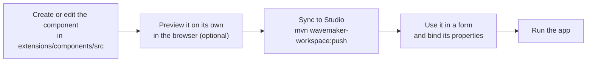

# WMX components

**WMX components (WaveMaker Extension components)** let you add your own React components to a WaveMaker web app. Once added, a component works like a built-in widget. You bind its properties to variables, handle its events on the page, and use it inside forms.

WMX components in React web apps are not supported in Angular apps. They work only in React web apps.

WMX components are also available for [React Native mobile apps](/docs/user-interfaces/mobile/enterprise-capabilities/wmx/). The folder layout and `wmx.json` format are the same. The component code differs: web components render HTML elements, mobile ones render React Native views.

## When to use one

Use a WMX component when the widget library has no control for what you need, for example a multi-select with chips, a scheduling picker, a chart, or a third-party React library with properties you want to set from Studio.

## What you provide

Each component lives in its own folder under `src/main/webapp/extensions/components/src/`:

```text
src/main/webapp/extensions/components/src/
└── MultiSelect/
    ├── index.tsx     # the component (default export)
    ├── wmx.json      # properties, events and styles shown in Studio
    ├── icon.svg      # optional icon for Studio
    └── package.json  # optional, for extra libraries and local preview
```

A folder counts as a WMX component only if it contains `wmx.json`. The folder name, the `name` in `wmx.json`, and the `componentname` used in page markup must all be the same.

## How you work with it



## Limitations

- WMX components (React) are not supported in Angular web apps.
- A WMX component cannot contain other widgets.
- Studio's design canvas shows a dashed placeholder labeled with the component name, not the real component. Run the app to see it.

## Next steps

- [Create a WMX component](./create-wmx-component.md)
- [Develop and test a WMX component locally](./develop-locally.md)
- [Use a WMX component in your app](./use-wmx-component.md)
