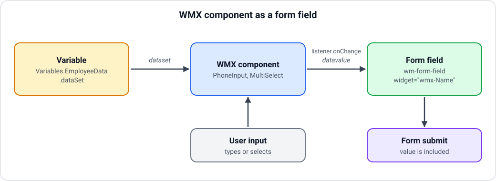

# Use a WMX component in your app

## Use it as a form field

In a form, add a field and choose the WMX component as the field's widget. Studio saves the field like this:

```html
<wm-form-field
  displayname="MultiSelect"
  widget="wmx-MultiSelect"
  type="custom"
  name="form_field10"
  key="form_field10"
  componentname="MultiSelect"
  dataset="bind:Variables.EmployeeData.dataSet"
  datafield="All Fields"
  displayfield="firstname"
  required="true"></wm-form-field>
```

`widget` is `wmx-` followed by the component name, and `componentname` is the component name. The other attributes are the component's properties. Here `dataset` is bound to a variable.

Because the component is a form field, the form reads its value like any other field, so it is included when the form is submitted. For the value to reach the form, the component must call `listener.onChange` when the user changes it (see the [WMX schema reference](./wmx-schema-reference.md#update-a-property-from-the-component) and the [examples](./wmx-examples.md)).



## Use it outside a form

Add the component to a page in the markup editor:

```html
<wmx-component componentname="StatusBadge" name="statusBadge1" text="Active"></wmx-component>
```

## Bind properties and handle events

- Bind a property to a variable, as with built-in widgets, for example `dataset="bind:Variables.EmployeeData.dataSet"`.
- Add a handler for an event declared in `wmx.json` as an attribute, for example `onClick="statusBadge1Click()"`, and define the function in the page script.

## Use it from page scripts

```js
Page.Widgets.statusBadge1.text = "Inactive";
```

## Style it

- Set the default look in the `styles` section of `wmx.json`.
- Add a class with the `classname` attribute and style it in `app.css` or the page CSS.

## Limitations

- WMX components (React) are not supported in Angular web apps.
- A WMX component cannot contain other widgets.
- The design canvas shows a placeholder. Run the app to see the component.
