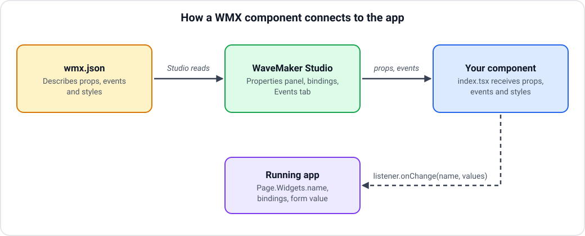

# WMX component schema

Each WMX component has UI code in `index.tsx`, metadata in `wmx.json`, and an optional icon. For an overview, see [WMX components](./index.mdx).



## Component structure

```text
ComponentName/
├── index.tsx
├── wmx.json
└── icon.svg (optional)
```

| File      | Purpose                               |
| --------- | ------------------------------------- |
| index.tsx | The component and its logic           |
| wmx.json  | Defines properties, events and styles |
| icon.svg  | Optional Studio icon                  |

The folder name, the `name` in `wmx.json`, and the `componentname` used in page markup must be the same.

## wmx.json overview

`props`, `events` and `styles` are **maps**. The key is the name Studio and the app use, and the value is the schema entry.

```json
{
  "name": "Carousel",
  "displayName": "Carousel",
  "description": "Image carousel",
  "webSupport": true,
  "iconUrl": "icon.svg",
  "props": {},
  "events": {},
  "styles": {}
}
```

### Metadata fields

| Field       | Description                                           | Required | Default |
| ----------- | ----------------------------------------------------- | -------- | ------- |
| name        | Unique component identifier. Matches the folder name. | Yes      | none    |
| displayName | Label shown in Studio                                 | No       | `name`  |
| description | Help text                                             | No       | none    |
| iconUrl     | Relative path to the icon, for example `icon.svg`     | No       | none    |
| webSupport  | Set to `true` for web apps                            | No       | `false` |
| props       | Map of properties                                     | No       | none    |
| events      | Map of events                                         | No       | none    |
| styles      | Map of style slots                                    | No       | none    |

### Property schema

| Field        | Description                                        | Required | Default  |
| ------------ | -------------------------------------------------- | -------- | -------- |
| name         | Property identifier. Matches the map key.          | Yes      | none     |
| displayName  | Label in Studio                                    | No       | `name`   |
| description  | Help text                                          | No       | none     |
| type         | `string`, `number`, `boolean`, `object` or `array` | No       | `string` |
| defaultValue | Initial value when the widget is placed on a page  | No       | none     |

```json
"props": {
  "dataset": { "name": "dataset", "type": "array", "defaultValue": [] },
  "autoplay": { "name": "autoplay", "type": "boolean", "defaultValue": true }
}
```

Each property you declare is passed to your component as a prop with the same name, and can be bound to a variable in Studio.

### Event schema

| Field       | Description                          | Required | Default |
| ----------- | ------------------------------------ | -------- | ------- |
| name        | Event identifier. Matches the key.   | Yes      | none    |
| displayName | Label in the Events tab              | No       | `name`  |
| description | Help text, and what the event passes | No       | none    |

```json
"events": {
  "onSlideChange": {
    "name": "onSlideChange",
    "displayName": "On Slide Change",
    "description": "Triggered when the slide changes. Receives the new index."
  }
}
```

Your component calls the event as a function prop, for example `onSlideChange?.(index)`. The handler you attach on the page runs.

### Style schema

| Field       | Description                             | Required | Default |
| ----------- | --------------------------------------- | -------- | ------- |
| name        | Style slot identifier. Matches the key. | Yes      | none    |
| displayName | Label in the Properties panel           | No       | `name`  |
| style       | Default CSS style object for the slot   | No       | none    |

```json
"styles": {
  "root": { "name": "root", "style": { "borderRadius": "8px" } },
  "caption": { "name": "caption", "style": { "fontSize": "14px" } }
}
```

Style values are CSS. Your component receives a `styles` prop with one entry per slot, shaped like `{ root: { style: {...} } }`.

## Properties WaveMaker provides

You do not declare these in `wmx.json`. Your component receives them:

| Prop        | What it is                                                                                                                                  |
| ----------- | ------------------------------------------------------------------------------------------------------------------------------------------- |
| `name`      | The widget name on the page                                                                                                                 |
| `styles`    | The style slots from `wmx.json`, with any changes made in Studio                                                                            |
| `classname` | The class set on the widget. Put it on the outermost element.                                                                               |
| `disabled`  | Whether the widget is disabled                                                                                                              |
| `listener`  | Lets the component update its own properties in the app. See [Update a property from the component](#update-a-property-from-the-component). |

`show` is handled for you. When it is false, WaveMaker hides the component.

In a form field, the component also receives the field's settings, such as `datavalue` (the field value), `readonly` and `required`, when you declare them in `wmx.json`.

Do not declare `show`, `name`, `disabled`, `classname`, `styles` or `showindevice` in `wmx.json`.

## index.tsx overview

```tsx
import React from "react";

const MyComponent = ({ title = "Hello", classname = "", styles }) => (
  <div className={classname} style={styles?.root?.style}>
    {title}
  </div>
);

export default MyComponent;
```

- Export the component as the **default export**.
- Accept props that match `props` and `events` in `wmx.json`.
- Apply `classname` and the `root` style to the outermost element.

## Update a property from the component

When the component itself changes a property, such as the selected value of an input or the current slide of a carousel, tell the app:

```tsx
listener?.onChange?.(name, { currentIndex: 2 });
```

The second argument holds the property names and their new values. After this call, bindings to `currentIndex` update, and page scripts read the new value from `Page.Widgets.<name>.currentIndex`. This is how built-in widgets report their own changes.

## icon.svg guidelines

- SVG format only
- Transparent background
- Stroke color `#737373`

## Summary

`wmx.json` describes what Studio shows. `index.tsx` is your React code. The props above connect the two.
